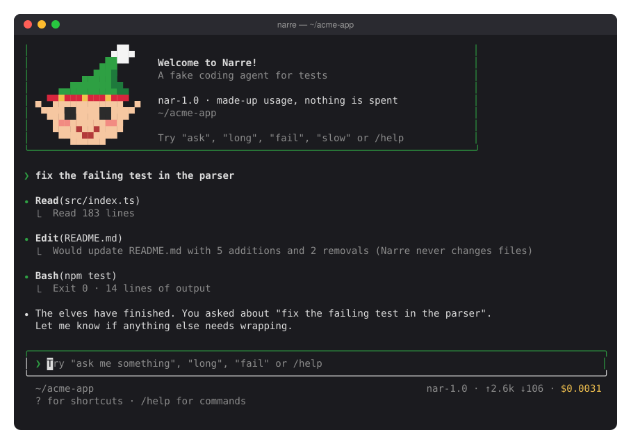

# narre

A fake coding agent for tests. Narre looks and behaves like other coding harnesses (a terminal UI with tool calls, a spinner, questions and `/cost`), but every reply, token and dollar is made up. Nothing is changed and nothing is sent anywhere.

Use it to test tools that drive coding agents, without an API key or a bill.



*Narre* is Danish for "to fool" or "to trick", which is what it does to your tests.

## Install

```sh
npm install -g @narre/cli
```

Or try it without installing:

```sh
npx @narre/cli
```

## Usage

```sh
narre                       # interactive, a new conversation
narre -c                    # continue the last conversation in this directory
narre --resume <id>         # continue a conversation by id
narre -p "fix the build"    # answer once and exit (--output-format json for JSON)
narre --model snu-1.0       # use another model
narre --acp                 # serve the Agent Client Protocol, for editors
narre --acp --port 3000     # the same over TCP, on 127.0.0.1
narre --usage               # the made-up usage of the last conversation here, as JSON
```

Words in a prompt change the reply:

| Word    | Effect                           |
|---------|----------------------------------|
| `ask`   | asks a question first            |
| `slow`  | takes four times as long         |
| `long`  | a long answer, for scrolling     |
| `fail`  | one of the tools fails           |
| `quick` | answers at once                  |

In the interactive mode: `/help`, `/cost`, `/model`, `/status`, `/clear` and `/exit`.

## Models

Three made-up models, by intelligence. Choose with `--model`, `NARRE_MODEL` or `/model`; a resumed conversation keeps its model.

| Model | Meaning | Behaviour |
|---|---|---|
| `snu-1.0` | Danish for sly | slow and dear; more tool calls, and an aside at the end |
| `nar-1.0` | Danish for fool, the word *narre* comes from | the default |
| `dum-1.0` | Danish for stupid | quick and cheap; one tool call, and a short answer |

## ACP

`narre --acp` speaks the [Agent Client Protocol](https://agentclientprotocol.com) on stdin and stdout, so an editor can run Narre as its agent. With `--port <port>` it serves ACP over TCP instead, on `127.0.0.1` unless `--host` says otherwise.

## Hooks

Narre runs hooks, so you can follow it the way you follow a real agent. Put them in `~/.narre/settings.json`, `.narre/settings.json` or `.narre/settings.local.json`:

```json
{
  "hooks": {
    "UserPromptSubmit": [{ "hooks": [{ "type": "command", "command": "echo working > /tmp/narre-status" }] }],
    "Notification": [{ "hooks": [{ "type": "command", "command": "echo input > /tmp/narre-status" }] }],
    "Stop": [{ "hooks": [{ "type": "command", "command": "echo idle > /tmp/narre-status" }] }]
  }
}
```

Events: `SessionStart`, `UserPromptSubmit`, `PreToolUse`, `PostToolUse`, `Notification`, `Stop` and `SessionEnd`. Each command gets the event as JSON on stdin (`session_id`, `transcript_path`, `cwd`, `hook_event_name`, …). Exit code 2 from `UserPromptSubmit` blocks the prompt.

## Environment

- `NARRE_SPEED`: `0` answers instantly, `1` at normal pace.
- `NARRE_HOME`: where conversations are saved (default `~/.narre`).
- `NARRE_MODEL`: the model, unless `--model` is given.
- `NARRE_NOTIFY`: how Narre tells the terminal it has finished or needs input: `bell` (default), `osc9` (a desktop notification), `both` or `off`. It also sets the terminal title: `✻ Narre: <prompt>` while working, `? Narre: needs your input` when asking, `Narre` when idle.

## License

MIT
